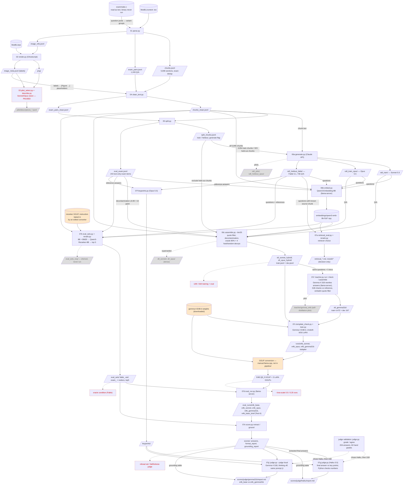

# RAFT-001 pipeline overview (E4B: Claude-teacher run + 31B-teacher run)

As of 2026-11-11 (ModEL fine-tuning closed). Sources: `pipeline/*.py`, `data/model/`.

## Flowchart

Rectangles are scripts, slanted boxes are files, cylinders are external inputs. Red dashed = paused or not built; grey = output nothing downstream uses; orange = produced outside `pipeline/`.

## Stages

| # | Script | In | Out | Model |
|---|---|---|---|---|
| 01 | `parse.py` | `ModEL/content/*.tex`, `exammake.c` (read as text for variant groups) | `chunks.jsonl` (5,846), `exam_pairs.jsonl` (1,249), `image_refs.jsonl` | none |
| 02 | `render.py` | `image_refs.jsonl`, `ModEL/eps/` | `png/` (7,619), `image_meta.jsonl` (labels) | none (Ghostscript) |
| 03 | `pilot_select.py`, `describe.py` | `png/`, `image_meta.jsonl` | `pilot/descriptions_*.jsonl` | Sonnet 5.5 / Opus 5.5 vision. **Paused** |
| 04 | `clean_text.py` | `chunks.jsonl`, `exam_pairs.jsonl`, `image_meta.jsonl` | `chunks_clean.jsonl`, `exam_pairs_clean.jsonl` | none |
| 05 | `split.py` | the two clean files | `split_chunks.jsonl` (train/heldout + "can generate" flag), `eval_exam.jsonl` (243) | none |
| 06a | `generate.py` | `split_chunks.jsonl`, `chunks_clean.jsonl` | `raft_train/` (6,883 Q/A), `raft_train_opus/` (6,839), `raft_heldout_fable/` (736) | Sonnet 5.5, Opus 5.5, Fable 5.1 (Claude API) |
| 06b | `embed.py` | all chunks, exam questions, all generated questions | `embeddings/qwen3-emb-8b-f16/*.npy` | Qwen3-Embedding-8B (llama-server) |
| 06c | `assemble.py --bm25` | generated Q/A, embeddings, clean chunks, split, exam items (for decontamination) | `sft_{sonnet,opus}_hybrid/train.jsonl, dev.jsonl`, `decon_report.md` | none (stored embeddings + BM25) |
| 07a | `retrieval_eval.py`, `rerank.py` | Fable questions, embeddings from 3 embedders, reranker scores | `retrieval_raft_heldout_fable.md`, `rerank/*` | 3 embedders, 3 Qwen3 rerankers (comparison only) |
| 07b | `eval_sets.py` (`candidates` → `rerank.py` → `build`) | Fable Q/A, `eval_exam.jsonl`, embeddings, chunks | `eval_sets/{fable,exam}_{nodocs,top5}.jsonl` | Qwen3-Embedding-8B + BM25 → Qwen3-Reranker-8B (electronics instruction) |
| 07c' | `teacher.py` (`run` → `check` → `assemble` → `report`) | `sft_sonnet_hybrid/` (questions + docs kept, answers replaced) | `teacher/gemma31b/`, `sft_gemma31b/` (train 4,472, dev 167) | Gemma 4 31B (teacher and checker, llama-server) |
| 07c | `template_check.py`, `train.py` | `sft_*_hybrid/`, `sft_gemma31b/`, Gemma weights | `runs/e4b_{sonnet,opus,gemma31b}/adapter/` | Gemma 4 E4B-it, Unsloth LoRA |
| — | GGUF conversion (manual, llama.cpp, not in `pipeline/`) | adapters + base weights | E4B Q8_0 GGUF + 3 LoRA GGUFs | — |
| 07d | `eval_run.py` | `eval_sets/*`, GGUFs on llama-server | `eval_runs/e4b_{base,sonnet,opus,gemma31b,base_brief}/*.jsonl` | E4B ± adapter |
| 07e | `score.py extract` / `ground` | `eval_runs/`, `eval_sets/` | `scores/` (answers, `format_report.md`, `grounding_report.md`) | none |
| 07f | `keypoints.py` | `eval_exam.jsonl`, Fable reference answers | `keypoints/` (979 items, 2,720 points) | Opus 5.5 |
| 07g | `judge.py` | extracted answers, key points | `scores/judge/haiku/report.md` | Haiku 5.5 (validated against Sonnet + 60 hand grades) |
| 07g' | `judge.py --judge local` | extracted answers, key points | `scores/judge/gemma31b/report.md` | Gemma 4 31B, thinking off (validated on the same 204 answers + 60 hand grades) |
| diag | `serve_check.py` | trained adapter, served outputs | `serve_check/*/report.md` | E4B bf16 (served GGUF adapter behaves like the trained one) |

## Key facts that are easy to get wrong

- **Figures** were not removed. Each became a text placeholder (`[Figure image_2041: labels V1, R1, …]`) built from labels in the diagram files; 3,675 of 5,846 chunks contain one. The exam eval keeps only items with no figure: 243 of 1,249.
- **Retrieval is offline.** No live index: embeddings are `.npy` files, and retrieval runs once when `eval_sets.py` builds the prompt files. The model gets a prompt that already holds 5 documents.
- **Training questions:** Sonnet and Opus each wrote both questions and answers (1–4 per chunk, verbatim quotes, short final answer) from the same 3,054 training chunks. Two separate LoRA adapters were trained, one per set, on Gemma 4 E4B-it (the instruction-tuned model).
- **Decoys in training:** every example has 5 documents. 80% = source chunk + 3 hard decoys (ranks 3–20 of embedding + BM25 search) + 1 random; 20% = no source chunk, 5 decoys. Decoys exclude near-duplicates of the source (cosine ≥ 0.95), chunks containing the answer's quotes, and held-out chunks.
- **Decoys in eval:** none planted. Top-5 = whatever the retriever returns. Fable: source chunk in the top 5 for 98.4%. Exam: no source chunk exists.
- **Fable chunks:** 16 held-out modules (323 chunks). They are held out from **training only**; they stay in the retrieval corpus, because the top-5 condition must find them. Fable questions are eval queries; their answers became references, then key points. They were also used to pick the retriever (each question knows its source chunk).
- **Socratic practice problems:** 2,004 `question` chunks (no answers) are in the retrieval corpus but were never used to generate training Q/A. They appear as ~15% of training decoys and 32% of exam top-5 docs (10% on Fable). The adapters' exam-with-docs loss grows with their count, and on exam top-5 54–58% of the adapters' quotes appear nowhere.
- **Scoring:** the final answer (text after the last `<ANSWER>`) is graded against key points Opus wrote once per item; numbers are compared by Python with a tolerance. Judge: Haiku for the Claude-teacher run, a local Gemma 4 31B for the 31B-teacher run. Scores from different judges are not comparable (31B is ~0.03 more lenient on conceptual partial credit). `score.py ground` separately checks the reasoning's quotes against the documents.
- **31B-teacher data:** same questions and documents as `sft_sonnet_hybrid`; only the answers are new. Kept only if 31B's final answer matches the Claude reference (checked by 31B) and every quote is verbatim in the documents. 31B declines 42% of no-oracle examples ("not in the documents"), so the kept set is ~10% no-oracle vs 20% before.

## Results

Haiku judge (Claude-teacher run):

| score | exam nodocs | exam top5 | Fable nodocs | Fable top5 |
|---|---|---|---|---|
| e4b_base | 0.797 | 0.816 | 0.683 | 0.875 |
| e4b_sonnet | 0.722 | 0.621 | 0.595 | 0.824 |
| e4b_opus | 0.701 | 0.625 | 0.606 | 0.819 |
| paired difference vs base (Sonnet / Opus) | −0.08 / −0.10 | −0.20 / −0.19 | −0.09 / −0.08 | −0.05 / −0.06 |

31B judge (31B-teacher run):

| score | exam nodocs | exam top5 | Fable nodocs | Fable top5 |
|---|---|---|---|---|
| e4b_base | 0.796 | 0.821 | 0.738 | 0.914 |
| e4b_gemma31b | 0.748 | 0.754 | 0.708 | 0.873 |
| paired difference, 95% CI | −0.048 [−0.095, +0.001] | −0.067 [−0.144, +0.021] | −0.030 [−0.049, −0.012] | −0.041 [−0.055, −0.027] |

Base beats all three adapters everywhere. Under the 31B judge, the Fable gaps are clear and the exam gaps are within noise (31 groups). Base gains ~+0.18–0.19 from documents on Fable and ~0 on the exam. The 31B-teacher adapter writes longer answers (median 300–690 tokens vs 165–280 for the Sonnet adapter) and invents far fewer quotes on exam top5 (11% vs 58% not found).

## Gaps

**Planned but not built, or built but not run**
- 03 figure descriptions: pilot only. Drawing-answer exam items depend on it.
- Answer typing and numeric extraction: absorbed into `keypoints.py`. Per-topic tags and reporting: not built.
- Oracle condition for Fable: not built.
- Refusal set, faithfulness judge: not designed.
- Index headers: deferred. Tagging the 8 exam groups whose text is in the corpus: proposed only.
- "Base + thinking on" baseline: run 2026-11-15 on exam no docs and Fable top 5 (31B judge); no clear difference from thinking off.
- 12B / 31B: supported by `train.py`, never trained.
- `e4b_sonnet`, `e4b_base_brief` under the 31B judge (would put all configs on one judge): not run.
- Publishing `sft_gemma31b`: held off.
- `eval_run.py --lora-scale` 0.5 / 0.25: built, sanity runs only.
- Second source (OSHA): not started.

**Outputs nothing downstream uses**
- `pilot/descriptions_*` (and `png/`, which only feeds that paused step).
- `raft_pilot/`, `raft_heldout_opus/`.
- `sft_sonnet/`, `sft_opus/` (dense decoys, superseded by `_hybrid`).
- 0.6B / embeddinggemma embeddings, 0.6B/4B and default-instruction reranker runs (retriever choice only).
- `eval_sets_noq/` (shelved, never run).
- `teacher/gemma_e4b/` (self-distillation pilot, 100 records), `judge_val/gemma_e4b*`, `judge_val/gemma31b_think/` (judge-choice runs only).
- `runs/e4b_sonnet_pilot/`, `keypoints_pilot/`, `eval_runs/_pilot_max1024/`, `runs/*/checkpoints/`.
- The 1,006 figure-dependent exam pairs in `exam_pairs_clean.jsonl`.
- `data/model/user_eval/` (empty).

**Inputs nothing in `pipeline/` produces**
- Gemma weights (downloaded by hand).
- GGUF files: converted by hand with llama.cpp plus the transformers 5.x workaround; not reproducible from the repo. `adapter_config.json` records a different base path than the docs.
- Reranker GGUF: electronics instruction set by editing llama.cpp's `conversion/qwen.py`; a converter copy sits in `data/model/rerank/convert_hf_to_gguf.py`.
- The 2026-11-04 practice-problem-doc analysis: one-off script, not in `pipeline/`.
- Hand grades (`judge_val/human.jsonl`): manual input via `judge.py grade` (expected).

## "Older question generator" and "near-duplicate removal"

No separate scripts exist in `pipeline/`, and git history has no deleted scripts.
- **Older question generator:** either `exammake` (Kuphaldt's C exam generator; binary never run, `parse.py` reads `exammake.c` as text for variant groups only) or the pilot path of `generate.py` (`run` → `raft_pilot/`, unused; same script as the batch run).
- **Near-duplicate removal** is spread across scripts, all in use:
  - `parse.py`: exact duplicate sections (7,604 → 5,846).
  - `assemble.py`: training questions near exam items (cosine ≥ 0.80 or shared 13-gram; 90 Sonnet / 99 Opus dropped), and decoys near the source chunk (≥ 0.95).
  - `retrieval_eval.py`: counts a chunk containing all the answer's quotes as a hit.
  - `pilot_select.py`: near-duplicate images (paused figure step only).
